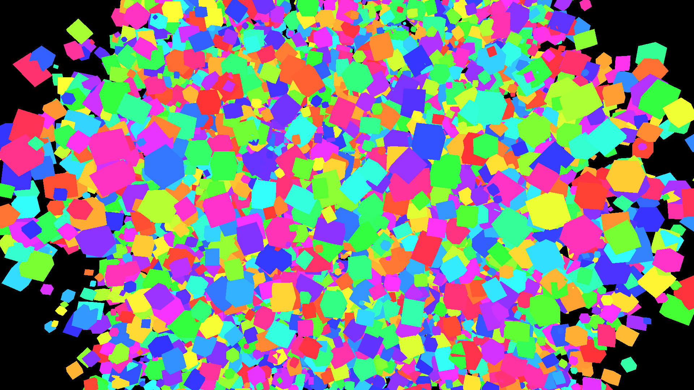
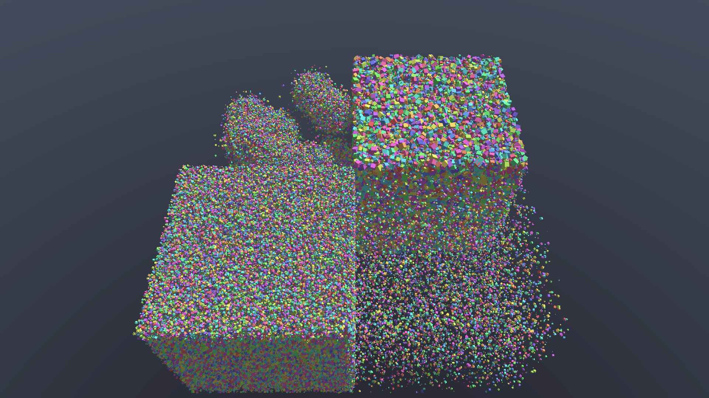

# Optimizing RT
Hardware: RTX 3060 at 1920x1080.

## Brute Force
A compute shader runs one thread per pixel, and every thread tests its ray against every cube. There is no acceleration structure, and the cube data sits in system RAM.

| Run | Cubes | GPU time per frame |
| --- | --- | --- |
| Estimated | 1,000,000 | 64.6 s |

## Staging Buffer
The cube data is copied into VRAM once, through a staging buffer. Before, the GPU fetched it from system RAM over PCIe every time its 3 MB L2 cache missed, which happens constantly with 61 MiB of cubes. Now the 61 MiB crosses PCIe once (~3 ms) and every cache miss goes to VRAM instead.

| Run | Cubes | GPU time per frame |
| --- | --- | --- |
| Brute Force | 1,000,000 | 64.6 s |
| Staging Buffer | 1,000,000 | 39.7 s |

## Bounding Sphere
Each cube gets a bounding sphere (16 bytes), and the ray is tested against it before the full box test. The sphere test is a few multiply-adds with no division, and it rejects almost every cube, so the 64-byte matrix and the expensive box test are only needed on a near-hit. The rendered image is identical to the previous step.

| Run | Cubes | GPU time per frame |
| --- | --- | --- |
| Brute Force | 1,000,000 | 64.6 s |
| Staging Buffer | 1,000,000 | 39.7 s |
| Bounding Sphere | 1,000,000 | 17.7 s |

## Grid Rejection
Cubes are bucketed into a 16x16x16 grid by their center. Each ray first tests the 4,096 cell boxes, padded by the largest cube radius, and only tests the cubes inside the cells it passes through. That is about 10k tests per ray instead of 1M. The rendered image is identical to the previous step.

| Run | Cubes | GPU time per frame |
| --- | --- | --- |
| Brute Force | 1,000,000 | 64.6 s |
| Staging Buffer | 1,000,000 | 39.7 s |
| Bounding Sphere | 1,000,000 | 17.7 s |
| Grid Rejection | 1,000,000 | 0.34 s |

A frame is now fast enough to render in a single dispatch instead of tiles: 0.28 s.

## Grid Traversal (3D-DDA)
Instead of testing all 4,096 cells, each ray walks only the cells it crosses, nearest first, and stops as soon as its closest hit lies inside the current cell. For this, every cube is listed in every cell its bounding box overlaps (39% duplicates), so no cell padding is needed. The rendered image is identical to the previous step.

| Run | Cubes | GPU time per frame |
| --- | --- | --- |
| Brute Force | 1,000,000 | 64.6 s |
| Staging Buffer | 1,000,000 | 39.7 s |
| Bounding Sphere | 1,000,000 | 17.7 s |
| Grid Rejection | 1,000,000 | 0.28 s |
| Grid Traversal | 1,000,000 | 10.7 ms |

1 million cubes now render at 93 FPS.

## Benchmark Views and Grid Size
The camera starts inside the cloud, where every ray hits something within ~17 units, so only ~0.1% of the cubes are ever visible. That is the easy case for grid traversal. From here on every step is measured in three views:

- **dense-inside**: the original view, camera inside the cloud.
- **dense-outside**: the same cubes, camera 800 units back with the whole cloud in view.
- **sparse-inside**: the same 1M cubes in a 125x larger volume; about half the rays escape without a hit (the hard case).

Grid traversal, median GPU time per frame at each grid size:

| Grid size | dense-inside | dense-outside | sparse-inside |
| --- | --- | --- | --- |
| 8 | 44.6 ms | 14.8 ms | 188.8 ms |
| 16 | 9.75 ms | 4.22 ms | 41.9 ms |
| 24 | 4.28 ms | 2.48 ms | 19.1 ms |
| 32 | 2.67 ms | 1.44 ms | 13.1 ms |
| 48 | 1.39 ms | 1.05 ms | 7.03 ms |
| 64 | 1.16 ms | 1.06 ms | 5.44 ms |
| 96 | 1.33 ms | 1.86 ms | 4.53 ms |
| 128 | 1.98 ms | 1.50 ms | 4.60 ms |

64 is within ~20% of the best in every view. Dense views get slower beyond it because smaller cells mean more duplicate entries and more steps per ray; the sparse view keeps improving up to 96 because its rays travel far. Grid rejection is best at 12-16 in every view (91-255 ms), 100-200x slower than traversal.

## Uneven Scene
A uniform grid is supposed to struggle with uneven scenes: a few cells end up holding thousands of cubes. A fourth view tests that: the same 1M cubes in 50 tight clusters of 20k, scattered through the large, mostly empty volume of the sparse scene.

Grid traversal, median GPU time per frame:

| Grid size | dense-inside | dense-outside | sparse-inside | clustered |
| --- | --- | --- | --- | --- |
| 32 | 2.22 ms | 1.23 ms | 12.7 ms | 18.9 ms |
| 64 | 1.15 ms | 0.83 ms | 4.91 ms | 4.17 ms |
| 96 | 1.58 ms | 1.78 ms | 4.02 ms | 3.15 ms |

The grid handles it well: clustered is faster than sparse. A ray entering a cluster hits something in its first cell or two and stops, and rays that miss the clusters cross cells that are almost all empty, which cost a step but no tests. The grid's real weak spot is space that rays cross without hitting anything, like the thinly filled sparse scene.

## One Scene, With Shading
From here on there is one benchmark scene: a box split into four quadrants, each a different challenge (1M cubes in total). A camera high above sees all four:

- **dense** (front left): 300k cubes, rays hit something almost immediately.
- **sparse** (front right): 10k cubes, rays cross many cells and often escape.
- **clustered** (back left): 400k cubes in 20 tight clusters.
- **mixed sizes** (back right): 290k cubes from 0.2 to 8 units, mostly tiny with a few big ones that span many grid cells.

The cubes are now lit by a directional light. Shadows need a second ray per pixel: from the hit point toward the light, stopping at the first thing in the way.

| Grid size | flat | diffuse | shadows |
| --- | --- | --- | --- |
| 48 | 2.22 ms | 1.99 ms | 2.40 ms |
| 64 | 1.55 ms | 2.02 ms | 3.44 ms |
| 96 | 1.58 ms | 1.61 ms | 2.79 ms |

Diffuse lighting costs about the same as flat colors. Shadows add roughly 50-80%, not 100%: only lit surfaces trace a shadow ray, and a shadow ray can stop at its first hit. At these frame times the measurements are noisy (up to ±1 ms).

Fixing the colors along the way: the image was copied to the screen with a raw byte copy, which swapped red and blue and skipped the sRGB conversion. It is now blitted, which converts both.
